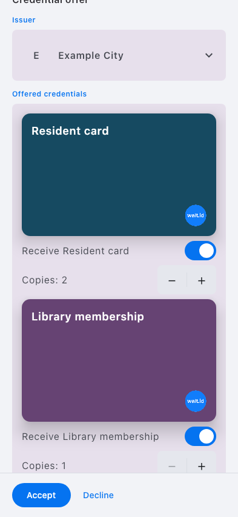

# Wallet visual catalogue

<!-- Generated by gallery.py --write-index. Do not edit. -->

Committed expected appearance from production UI with synthetic data. These images do not establish a fresh comparison or a completed app journey.

Open an image for its full size. Compact, large-text, dark and RTL captures are labelled explicitly. A missing renderer means that this catalogue has no reference for it.

## settings-root-default

**Settings**

| Compose Android | Compose iOS | Native iOS |
| --- | --- | --- |
|  |  |  |

## credential-details-identity

**Credential information**

| Compose Android | Compose iOS | Native iOS |
| --- | --- | --- |
|  |  |  |

## credential-media-loaded

**Credential images**

| Compose Android | Compose iOS | Native iOS |
| --- | --- | --- |
|  |  |  |

## batch-offer-two_targets_three_copies

**Receiving — selected credentials**

| Compose Android | Compose iOS | Native iOS |
| --- | --- | --- |
|  |  |  |

## batch-offer-two_targets_three_copies-second_target

**batch · offer · two targets three copies · second target**

| Compose Android | Compose iOS | Native iOS |
| --- | --- | --- |
|  |  | No reference |

## batch-offer-none_selected

**batch · offer · none selected**

| Compose Android | Compose iOS | Native iOS |
| --- | --- | --- |
|  |  |  |

## batch-result-saved_and_deferred

**Receiving — saved and deferred**

| Compose Android | Compose iOS | Native iOS |
| --- | --- | --- |
|  |  |  |

## payment-mixed_credentials-main

**Payment review**

| Compose Android | Compose iOS | Native iOS |
| --- | --- | --- |
|  |  | No reference |

## payment-mixed_credentials-details

**payment · mixed credentials · details**

| Compose Android | Compose iOS | Native iOS |
| --- | --- | --- |
|  |  | No reference |

## payment-mixed_credentials-requested_data

**payment · mixed credentials · requested data**

| Compose Android | Compose iOS | Native iOS |
| --- | --- | --- |
|  |  | No reference |

## payment-consent-main

**payment · consent · main**

| Compose Android | Compose iOS | Native iOS |
| --- | --- | --- |
| No reference | No reference |  |

## nearby-ready-qr

**Nearby sharing**

| Compose Android | Compose iOS | Native iOS |
| --- | --- | --- |
|  |  |  |
