# Wallet visual catalogue

<!-- Generated by gallery.py --write-index. Do not edit. -->

Committed expected appearance from production UI with synthetic data. These images do not establish a fresh comparison or a completed app journey.

Open an image for its full size. Compact, large-text, dark and RTL captures are labelled explicitly. A missing renderer means that this catalogue has no reference for it.

## wallet-home-empty

**wallet · home · empty**

| Compose Android | Compose iOS | Native iOS |
| --- | --- | --- |
|  |  | 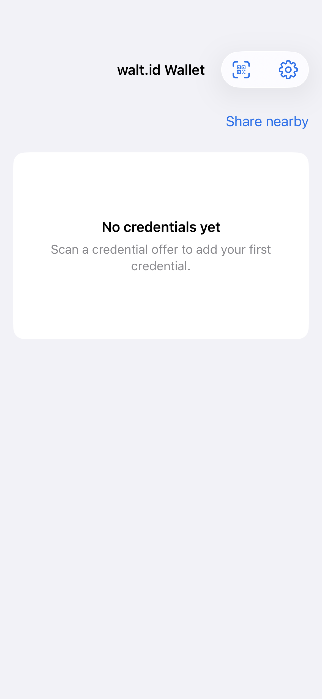 |

## wallet-home-credential

**Wallet — saved credential**

| Compose Android | Compose iOS | Native iOS |
| --- | --- | --- |
|  |  | 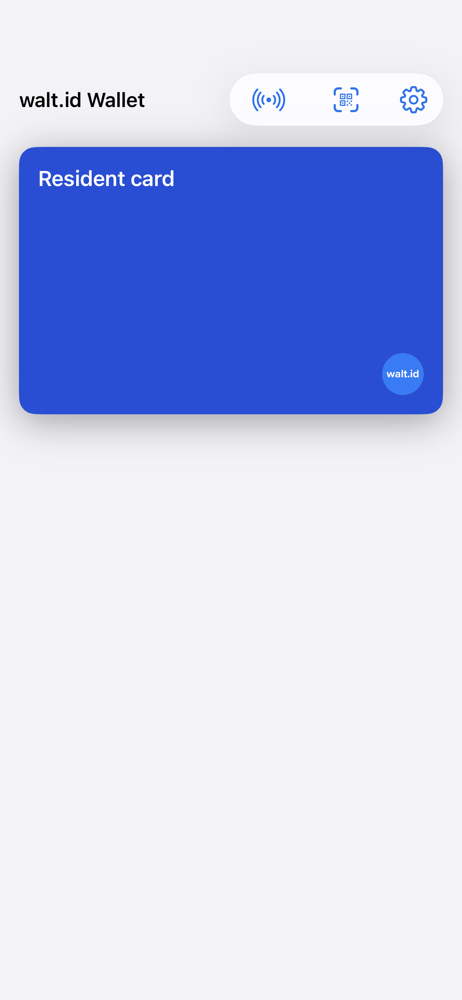 |

## wallet-scan-empty

**Scan or paste a request**

| Compose Android | Compose iOS | Native iOS |
| --- | --- | --- |
|  |  | 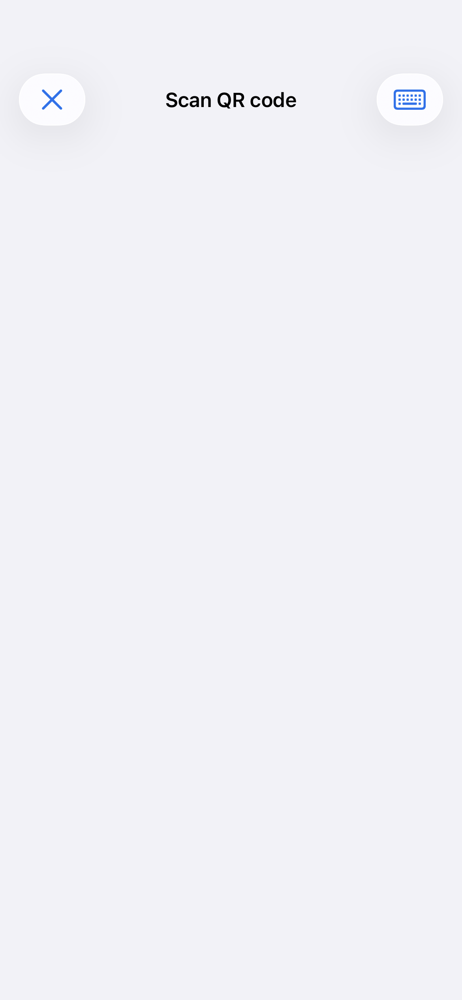 |

## wallet-scan-unsupported

**wallet · scan · unsupported**

| Compose Android | Compose iOS | Native iOS |
| --- | --- | --- |
| 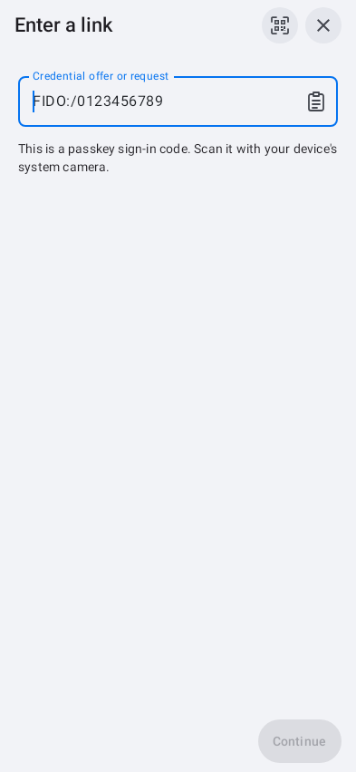 | 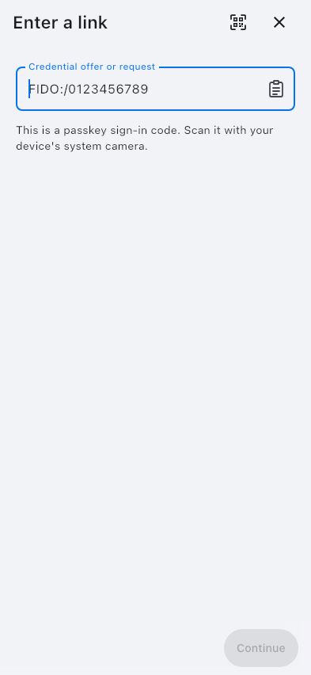 | 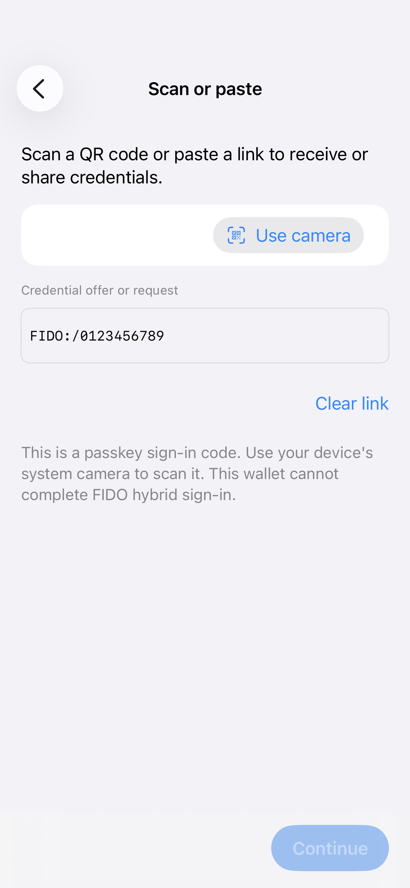 |

## wallet-scan-link

**wallet · scan · link**

| Compose Android | Compose iOS | Native iOS |
| --- | --- | --- |
|  |  | 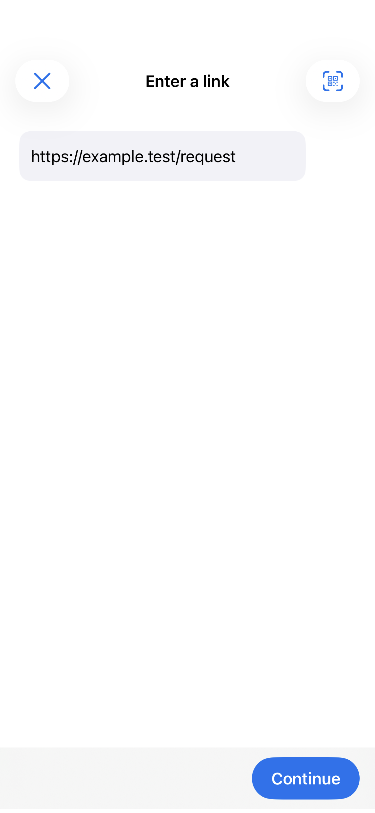 |

## settings-root-default

**Settings**

| Compose Android | Compose iOS | Native iOS |
| --- | --- | --- |
|  |  | 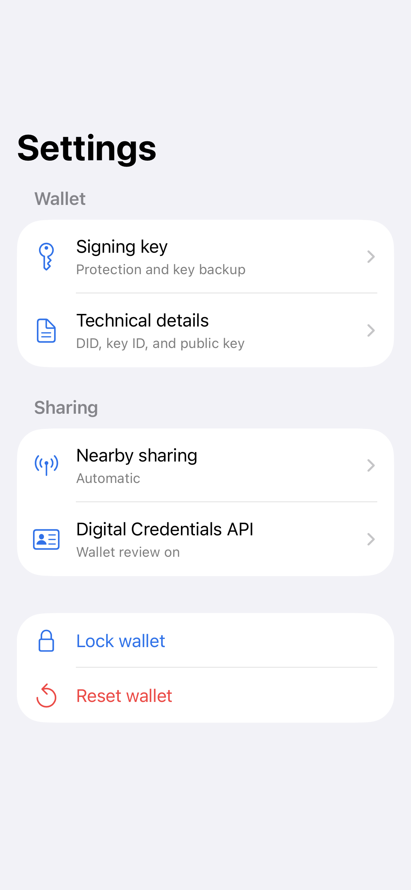 |

## credential-details-identity

**Credential information**

| Compose Android | Compose iOS | Native iOS |
| --- | --- | --- |
|  |  |  |

## credential-media-loaded

**Credential images**

| Compose Android | Compose iOS | Native iOS |
| --- | --- | --- |
|  |  | 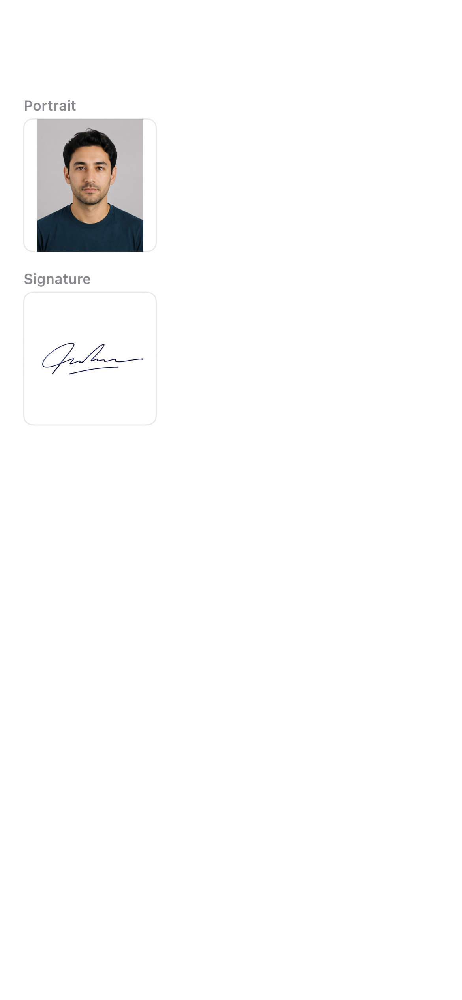 |

## batch-offer-two_targets_three_copies

**Receiving — selected credentials**

| Compose Android | Compose iOS | Native iOS |
| --- | --- | --- |
|  |  | 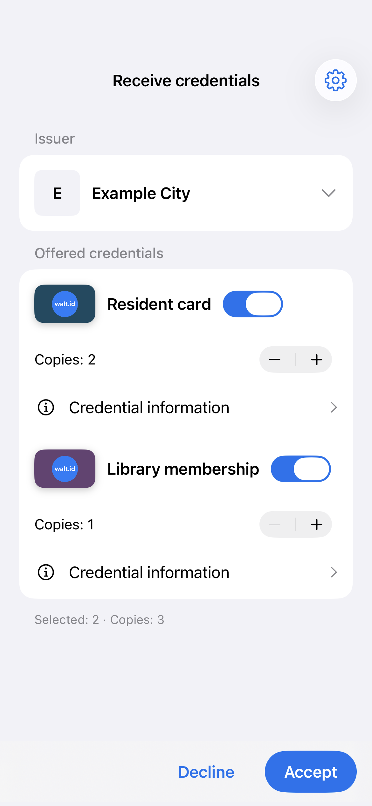 |

## batch-offer-none_selected

**batch · offer · none selected**

| Compose Android | Compose iOS | Native iOS |
| --- | --- | --- |
|  |  | 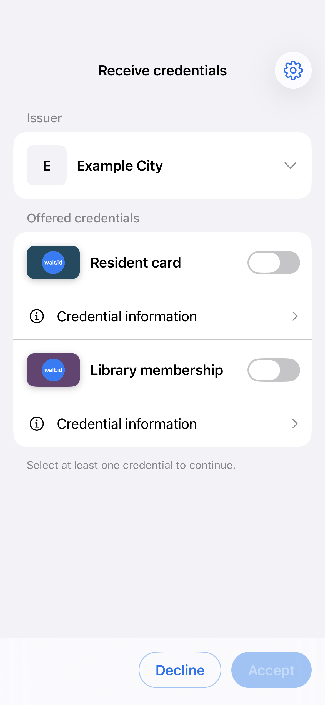 |

## batch-result-saved_and_deferred

**Receiving — saved and deferred**

| Compose Android | Compose iOS | Native iOS |
| --- | --- | --- |
|  |  | 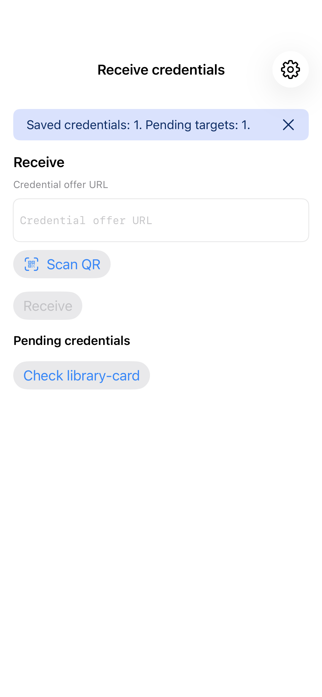 |

## payment-mixed_credentials-main

**Payment review**

| Compose Android | Compose iOS | Native iOS |
| --- | --- | --- |
|  |  | No reference |

## payment-mixed_credentials-details

**payment · mixed credentials · details**

| Compose Android | Compose iOS | Native iOS |
| --- | --- | --- |
|  |  | No reference |

## payment-mixed_credentials-requested_data

**payment · mixed credentials · requested data**

| Compose Android | Compose iOS | Native iOS |
| --- | --- | --- |
|  |  | No reference |

## payment-consent-main

**payment · consent · main**

| Compose Android | Compose iOS | Native iOS |
| --- | --- | --- |
| No reference | No reference | 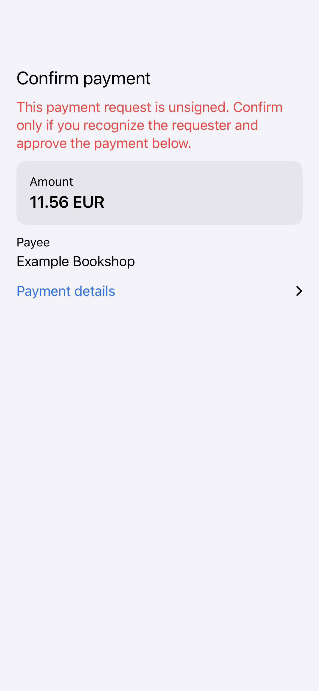 |

## nearby-ready-qr

**Nearby sharing**

| Compose Android | Compose iOS | Native iOS |
| --- | --- | --- |
|  |  | 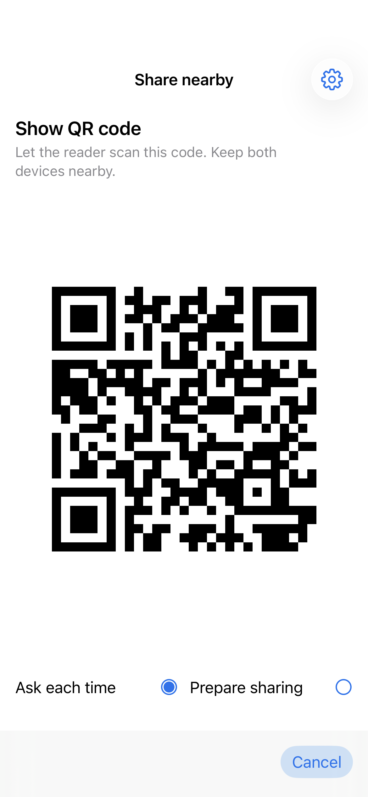 |

## onboarding-pin-setup

**Onboarding — choose a PIN**

| Compose Android | Compose iOS | Native iOS |
| --- | --- | --- |
|  |  | 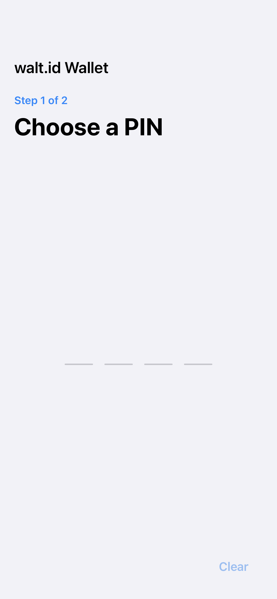 |

## onboarding-pin-mismatch

**onboarding · pin · mismatch**

| Compose Android | Compose iOS | Native iOS |
| --- | --- | --- |
|  |  |  |

## onboarding-pin-biometrics_enabled

**onboarding · pin · biometrics enabled**

| Compose Android | Compose iOS | Native iOS |
| --- | --- | --- |
| 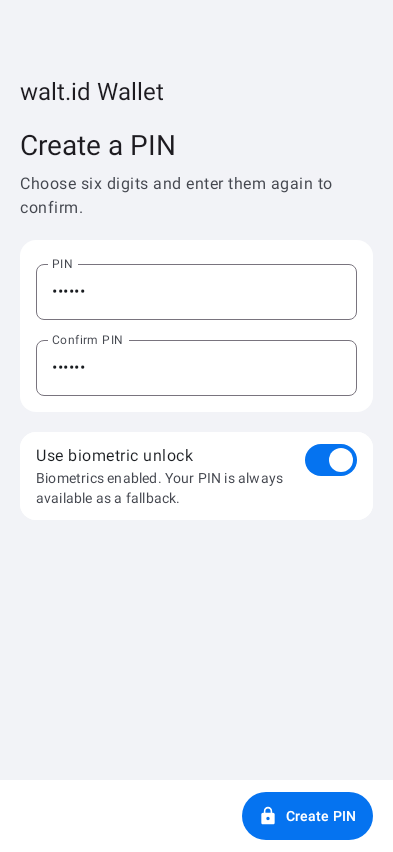 | 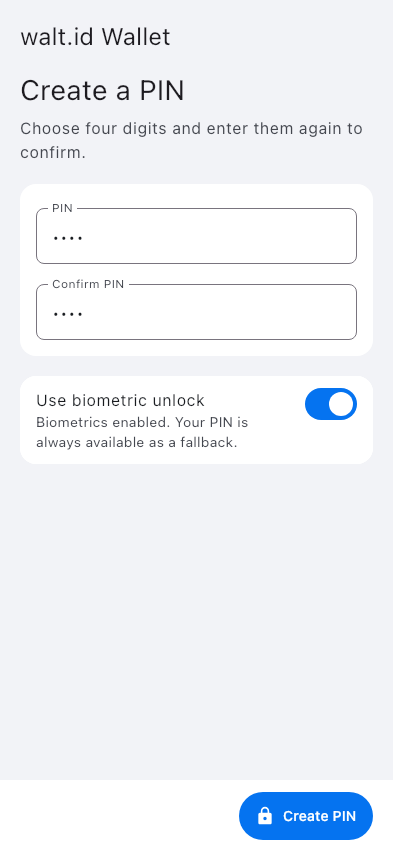 | 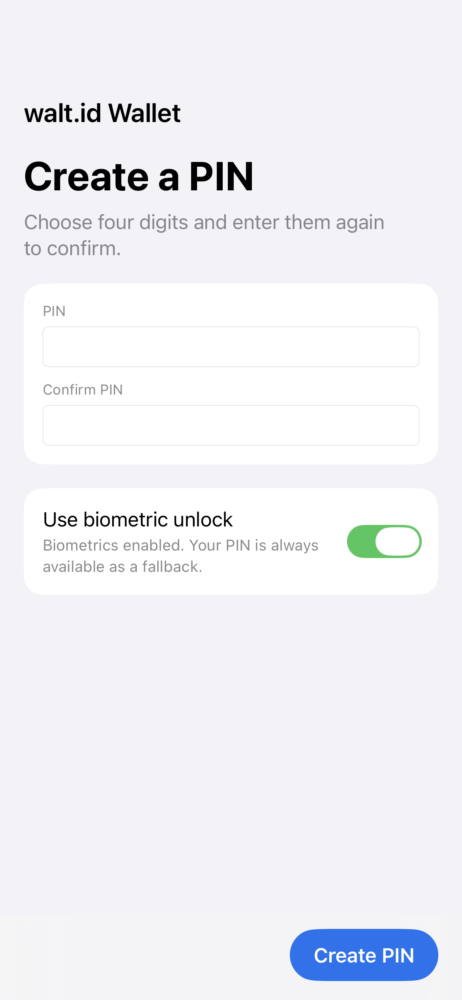 |

## credential-details-localized_metadata

**credential · details · localized metadata**

| Compose Android | Compose iOS | Native iOS |
| --- | --- | --- |
|  |  | 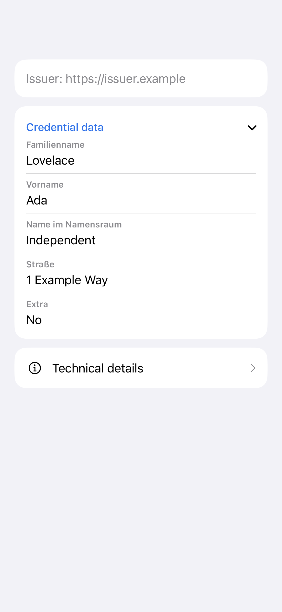 |

## batch-offer-definitions

**batch · offer · definitions**

| Compose Android | Compose iOS | Native iOS |
| --- | --- | --- |
|  |  | 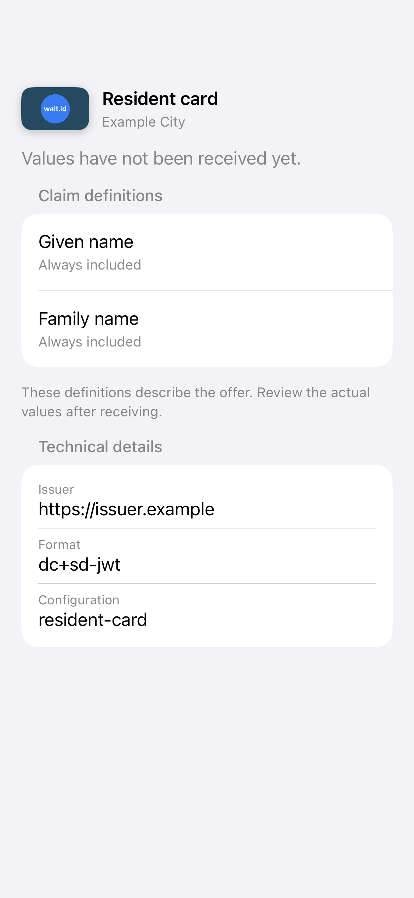 |

## batch-offer-compact_dark_large_text

**Receiving — compact, dark, large text**

| Compose Android | Compose iOS | Native iOS |
| --- | --- | --- |
|  320×568, 1.5× text, dark |  320×568, 1.5× text, dark | 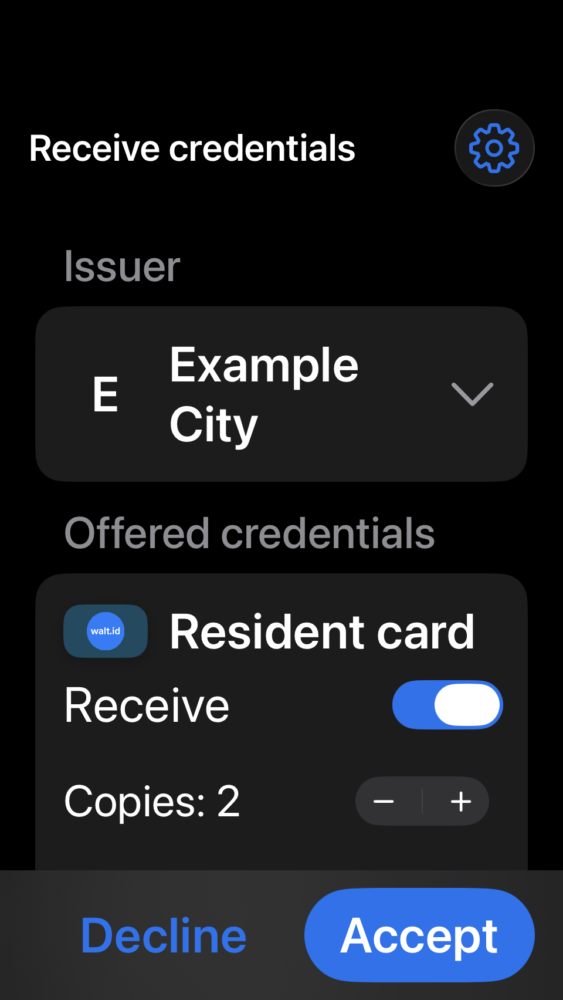 320×568, accessibilityMedium, dark |

## batch-offer-compact_dark_large_text-last_target

**batch · offer · compact dark large text · last target**

| Compose Android | Compose iOS | Native iOS |
| --- | --- | --- |
|  320×568, 1.5× text, dark |  320×568, 1.5× text, dark | No reference |
